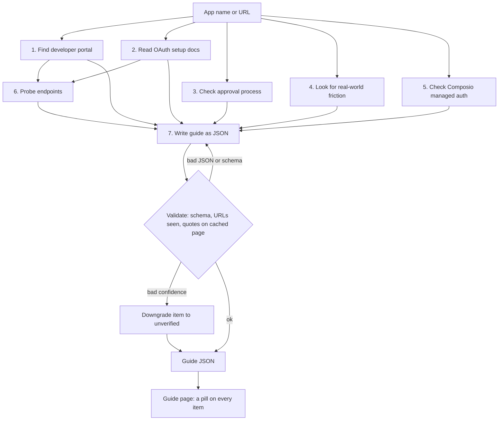

# OAuth Setup Navigator

**Live demo:** TODO: add the Render URL once deployed · **Repo:** https://github.com/syedpalvisha-oss/oauth-setup-navigator

## Problem

Before building an integration you need to know whether OAuth credentials take a minute, a week, or never, and what will block you. That answer is scattered across docs, approval pages, forums and the registration form itself, and a confident wrong answer costs days. The Navigator writes one guide per provider and tags every item with how well it is backed.

## My scope and why

Composio’s managed OAuth apps let developers prototype without registering anything. The pain starts at the move to production, when they need their own OAuth app and can’t tell whether that’s 5 minutes or 6 weeks. I focused on that mome
The core of every guide is a verdict: a difficulty tier, with setup time and approval wait shown separately, because “it takes 10 minutes to fill the form, then 4 weeks of review” is the thing developers get blindsided by. Some providers aren’t one tier: LinkedIn’s sign-in is instant, but its marketing APIs are partner-gated, so guides can tier each product.

I chose a small verified library plus a live agent rather than many unverified guides, and labelled every claim by evidence level. A wrong guide that looks confident is worse than no guide. My eval proved this: the agent got GitHub’s tier right but invented details, like an auto-generated secret and a scope review, that a reader would have trusted.

Out of scope: completing provider approvals, end-user connection flows, and the full 100-app library.

## How it works

Searching for an app runs a 7-stage agent (`server/agent/generateGuide.js`): stages 1-5 research in parallel (Tavily search plus a small Groq model), stage 6 probes live endpoints with no model, and stage 7 writes the guide as JSON and checks it.



- **Probes:** the docs page, the authorize endpoint with a dummy client ID, and `.well-known` discovery URLs, recording what it saw, including login walls. Falls back to plain fetches without Chromium.
- **Checks:** a `sourced` item must cite a URL the agent saw and quote it verbatim from the cached page. A failure downgrades the item to `unverified` instead of failing the guide.
- **Library:** committed guides in `server/data/guides/` (GitHub, Gmail, LinkedIn, Slack) load with no keys. Generated guides go to `server/data/generated/`, and a curated guide wins on a name clash.

## Evidence & what I learned

Every step, scope, prerequisite, blocker and claim carries one of these levels. A missing level means `unverified`.

| Level | Meaning |
|---|---|
| `tested` | A human, or a supervised browser agent, did the setup end to end. The agent can never assign this. |
| `agent_checked` | The agent probed a live endpoint and saw it. |
| `sourced` | An official docs page states it, backed by a verbatim quote found on that page. |
| `unverified` | Nothing official or observed backs it. Treat it as a lead. |

A supervised browser agent registered a real GitHub OAuth App (then deleted it). I compared that tested guide against a fresh agent run on "GitHub":

| Dimension | Tested guide | Agent said | Verdict |
|---|---|---|---|
| Tier | `instant` | `instant` | Right |
| Setup time | About 1 minute | `null`, unverified | Missed |
| Approval wait | None, live on registration | "None", unverified; summary implied a review step | Partial |
| Redirect URIs | A list of up to 10, optional wildcards, localhost accepted | A single "callback URL" | Partial |
| Client secret | Not created at registration; you click "Generate a new client secret" | "Copy the generated client secret" after creation | Wrong |
| Org-restriction blocker | Owner approval needed in orgs with "Access restricted" | `blockers: []` | Missed |
| OAuth App vs GitHub App | Tested comparison and a "need fine-grained permissions" blocker | Not mentioned | Missed |

Overall: 5 right, 2 partial, 3 wrong, 5 missed. Key corrections:

- **Label every item.** The wrong claims carried no label, so a reader would have trusted them. Every actionable item now has a confidence level, defaulting to `unverified`, shown as a pill on the guide page.
- **Verify against the full source.** Trimming page text to fit free-tier token limits once dropped sourced claims from 3 to 0, until verification was decoupled from prompt size.
- **Hands-on beats docs.** "Not stated in the docs" took a minute to settle in the real form.
- **Don't trust failed output.** Unusable stage 7 answers are no longer replayed from the cache, and failed runs save nothing.

Details: [`eval-results.md`](eval-results.md) and [`docs/learnings.md`](docs/learnings.md).

## Limitations

- **Forms behind a login are invisible.** Field names, what a form generates and how long it takes mostly stay `unverified` unless a human tests them.
- **`agent_checked` is coarse.** It confirms the cited URL was probed, not that the probe supports the step.
- **Only GitHub is human-tested.** The other committed guides are quote-checked agent output, and guides committed before per-item labels show `unverified` on unlabeled items.
- **Free-tier limits shape the design.** Groq allows about 8k tokens per minute per model, so research stages get about 1k tokens of context and back-to-back generations queue.
- **Guides go stale and state is per process.** Nothing re-checks `last_checked` dates, and the cache and rate limiter are in memory unless Upstash is configured.

## Scaling to 100

A proposal, not built:

- **Batch offline:** run `generate:guide` over a provider list, review, and commit, so users read the library instead of triggering live runs.
- **Queue and cache:** a job queue that schedules model calls against per-minute budgets, plus Upstash so guides survive restarts and are shared across instances.
- **Triage human testing:** test the highest-traffic providers with the most `unverified` items first. The GitHub test took about a minute and fixed several wrong claims.
- **Stay fresh and measured:** re-probe on a schedule and flag changes, and turn the GitHub comparison into a repeatable eval over every tested guide.

## Local setup

Requires Node 20.19 or later.

```
cp .env.example .env     # then add your own keys
npm run install:all
npm run dev              # client :5173, server :3001/api/health
```

| Variable | Needed for |
|---|---|
| `TAVILY_API_KEY`, `GROQ_API_KEY` | Generating new guides. The committed library works without them. |
| `GEMINI_API_KEY` | Optional fallback for stage 7 only. Leave blank to never call Gemini. |
| `UPSTASH_REDIS_REST_URL`, `UPSTASH_REDIS_REST_TOKEN` | Optional. Keeps generated guides across restarts; otherwise the cache is in memory. |
| `PORT` | Optional. Defaults to 3001; Render sets it. |

`npm run validate:guides --prefix server` checks committed guides against the schema. To deploy, follow [`DEPLOY.md`](DEPLOY.md). Keep keys in `.env` locally or in the Render dashboard; `.env` is git-ignored.
