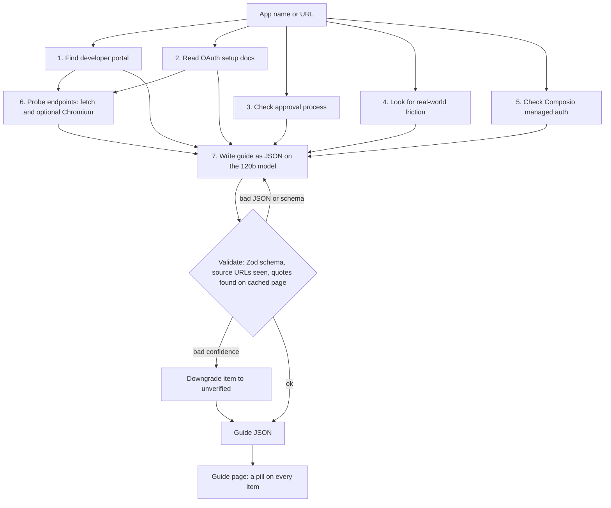

# OAuth Setup Navigator

An agent that researches how hard it is to get OAuth credentials from a provider, and writes a setup guide in which every claim says how much to trust it.

**Live demo:** TODO: add the Render URL once the service is deployed (see `DEPLOY.md`).

## Problem

Before you build an integration, you need to know whether you can get OAuth credentials in a minute, a week, or never, and what will block you on the way. That answer is scattered across developer docs, approval-process pages, forum threads and the registration form itself. Docs go stale, forms drift from the docs, and a confident summary that is wrong costs a developer days.

The Navigator turns that research into one guide per provider: a tier (instant, self-serve with review, review required, partner gated), setup time, approval wait, prerequisites, steps, scopes and blockers. Each item says whether a human tested it, the agent probed it, an official page states it, or nobody has checked it.

## My scope and why

TODO: write this section myself: which providers and questions I scoped in, what I left out, and why.

## How it works

Searching for an app runs a 7-stage agent (`server/agent/generateGuide.js`). Stages 1 to 5 run in parallel, each doing targeted Tavily searches and one small Groq model call. Stage 6 probes the provider's live endpoints with no model involved. Stage 7 writes the guide as JSON against a Zod schema, then checks it.



- **Research:** Tavily search results feed `openai/gpt-oss-20b` and `openai/gpt-oss-120b` on Groq. Gemini is an optional fallback for stage 7 only.
- **Probes:** stage 6 requests the docs page, the authorize endpoint with a dummy client ID and the `.well-known` discovery URLs. It records what it saw, including login walls. If Chromium isn't available it falls back to plain fetches.
- **Checks:** a `sourced` item must cite a URL the agent actually saw and include a verbatim quote that appears in the cached page text. A failure downgrades the item to `unverified` rather than failing the guide.
- **Library:** committed guides in `server/data/guides/` (GitHub, Gmail, LinkedIn, Slack) load on first run with no keys. Generated guides go to `server/data/generated/`, and a curated guide wins over a generated one with the same name.

## Evidence levels

Every step, scope, prerequisite, blocker and claim carries one of these. A missing level means `unverified`.

| Level | Meaning |
|---|---|
| `tested` | A human, or a supervised browser agent, did the setup end to end. The agent can never assign this. |
| `agent_checked` | The agent probed a live endpoint and saw it. |
| `sourced` | An official docs page states it, backed by a verbatim quote found on that page. |
| `unverified` | Nothing official or observed backs it. Treat it as a lead. |

## What I learned

The most useful thing I did was test the agent against reality. A supervised browser agent registered a real GitHub OAuth App (then deleted it), and I compared that tested guide against a fresh agent run on "GitHub". Full table in [`eval-results.md`](eval-results.md).

| Dimension | Tested guide | Agent said | Verdict |
|---|---|---|---|
| Tier | `instant` | `instant` | Right |
| Setup time | About 1 minute | `null`, unverified | Missed |
| Approval wait | None, live on registration | "None", unverified; summary implied a review step | Partial |
| Redirect URIs | A list of up to 10, optional wildcards, localhost accepted | A single "callback URL" | Partial |
| Client secret | Not created at registration; you click "Generate a new client secret" | "Copy the generated client secret" after creation | Wrong |
| Org-restriction blocker | Owner approval is needed in orgs with "Access restricted" | `blockers: []` | Missed |
| OAuth App vs GitHub App | Tested comparison and a "need fine-grained permissions" blocker | Not mentioned | Missed |

Across the eval: 5 right, 2 partial, 3 wrong, 5 missed, plus weak confidence labeling. The agent got the shape of the flow right and the form details wrong. The wrong claims carried no label, so a reader would have trusted them.

What changed because of it:

- **Every actionable item now carries a confidence level**, defaulting to `unverified`, and the guide page shows a pill on each one.
- **Evidence checks run on the full source**, not on whatever fit in the prompt. Trimming page text to fit free-tier token limits once dropped sourced claims from 3 to 0 until verification was decoupled from prompt size.
- **A short hands-on test beats a long list of unverified claims.** "Not stated in the docs" took a minute to settle in the form.

More in [`docs/learnings.md`](docs/learnings.md).

## Limitations

- **The agent can't see forms behind a login.** Registration details like field names, what a form generates and how long it takes mostly stay `unverified` unless a human tests them.
- **`agent_checked` is coarse.** It confirms the cited URL was probed, not that the probe supports the step. A re-run tagged "click New OAuth App" `agent_checked` because it had probed the login-walled page.
- **Only GitHub is human-tested.** The other committed guides are agent output with quote-checked claims. Guides committed before per-item labels show `unverified` on items nobody has labeled yet, including the tested GitHub guide.
- **Free-tier limits shape the design.** Groq allows about 8k tokens per minute per model, so research stages get roughly 1k tokens of context each, and two generations close together queue. Generating needs a Tavily and a Groq key. Without them the library still works.
- **Guides go stale.** Each carries a `last_checked` date, but nothing re-checks them automatically.
- **State is per process.** The cache is in memory unless Upstash is configured, and the rate limiter is per server.

## Scaling to 100

This is a proposal, not something built.

1. **Batch generation.** Run `npm run generate:guide` over a provider list offline, review the output, and commit it. Users then read the library rather than triggering live runs against free-tier limits.
2. **Rate-limit-aware queue.** Replace "two runs close together will queue" with a real job queue that schedules model calls against per-minute budgets, and use a paid tier for the model that stage 7 needs.
3. **Shared cache.** Turn on Upstash so generated guides and page text survive restarts and are shared across instances, and move the per-IP limiter to the same store.
4. **Triage human testing.** Rank providers by traffic and by how many items are still `unverified`, and test the top ones by hand first. The GitHub run took about a minute of supervised work and fixed several wrong claims.
5. **Keep it fresh.** Re-run probes on a schedule, diff the result against the stored guide, and flag a guide when a probe result changes.
6. **Score the agent.** Turn the GitHub comparison into a repeatable eval over every tested guide, so prompt changes show up as a number.

## Local setup

Requires Node 20.19 or later.

```
cp .env.example .env     # then fill in your own keys
npm run install:all
npm run dev
```

- Client: http://localhost:5173 (proxies `/api` to the server)
- Server: http://localhost:3001/api/health

Environment variables (see `.env.example`):

| Variable | Needed for |
|---|---|
| `TAVILY_API_KEY`, `GROQ_API_KEY` | Generating new guides. The committed library works without them. |
| `GEMINI_API_KEY` | Optional fallback for the final "Writing guide" stage. Leave blank to never call Gemini. |
| `UPSTASH_REDIS_REST_URL`, `UPSTASH_REDIS_REST_TOKEN` | Optional. Keeps generated guides across restarts; without them the cache is in memory. |
| `PORT` | Optional. Defaults to 3001; Render sets it. |

Useful commands:

```
npm run validate:guides --prefix server                      # check committed guides against the schema
npm run generate:guide --prefix server -- "<app or URL>"     # generate one guide (add --refresh to ignore an existing one)
```

To deploy on Render, follow [`DEPLOY.md`](DEPLOY.md). Keep API keys in `.env` locally or in the Render dashboard; `.env` is git-ignored.
